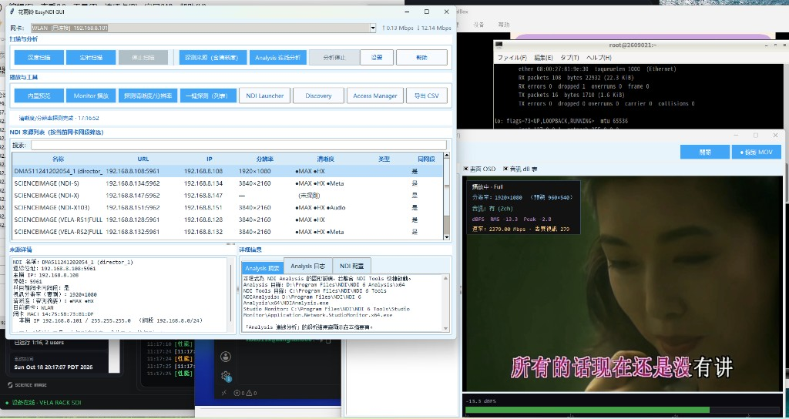

# 花雨铃 EasyNDI GUI

面向 NDI 的桌面工具：网卡筛选、来源扫描、内置预览（OSD / 音频 dB）、清晰度探测，以及 NDI Analysis / Tools 快捷入口。



## 环境

- Windows 10/11 或 macOS
- Python 3.13
- 已安装 [NDI SDK](https://ndi.video/)（`ndi-python`）及本机 NDI Tools / Analysis（可选）

## 安装与运行

```bash
pip install -r requirements.txt
```

Windows：

```bat
run.bat
```

macOS / Linux：

```bash
chmod +x run.sh && ./run.sh
```

首次运行可复制 `app_config.example.json` 为 `app_config.json`，在「设置」中填写 Analysis 与 Tools 路径。

## 说明

Made by [MoeDisk](https://github.com/MoeDisk)
